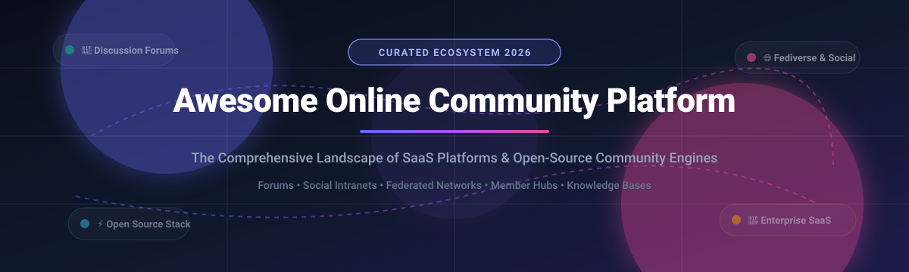

<p align="center">
  
</p>

# 🌐 Awesome Online Community Platform

<p align="center">
  <a href="https://github.com/ishandutta2007/Awesome-Awesome-Awesome"></a><a href="https://discord.gg/jc4xtF58Ve"></a>
  <a href="https://github.com/ishandutta2007/Awesome-Online-Community-Platform/stargazers"></a>
  <a href="https://github.com/ishandutta2007/Awesome-Online-Community-Platform/network/members"></a>
  <a href="https://github.com/ishandutta2007/Awesome-Online-Community-Platform/blob/main/LICENSE"></a>
  <a href="https://github.com/ishandutta2007"></a>
</p>

---

## 📌 Executive Summary & Repository Overview

Welcome to the definitive curated guide to **Online Community Platforms**, **Discussion Forums**, and **Social Networking Engines**. Whether you are an enterprise organization looking for an omnichannel customer portal, a creator building an audience membership community, or a developer deploying self-hosted, privacy-first community infrastructure, this directory compares leading commercial SaaS solutions and production-grade open-source software.

> **Category Focus:** Member engagement, discussion forums, social intranet, knowledge bases, creator communities, fediverse nodes, and decentralized networks.

---

## 📑 Table of Contents

- [📊 Sector Overview & Market Dynamics](#-sector-overview--market-dynamics)
- [☁️ SaaS & Hosted Community Platforms](#️-saas--hosted-community-platforms)
- [🔓 Open-Source GitHub Projects](#-open-source-github-projects)
- [🛠️ Architectural Guidance & Stack Selection](#️-architectural-guidance--stack-selection)
- [🤝 How to Contribute](#-how-to-contribute)
- [⭐ Star History](#-star-history)
- [💖 Support & Sponsorship](#-support--sponsorship)
- [⚖️ Disclaimer](#️-disclaimer)

---

## 📊 Sector Overview & Market Dynamics

The global online community platforms market was valued at approximately **$8.2 billion in 2024** and is projected to surpass **$21.5 billion by 2032**, expanding at a Compound Annual Growth Rate (CAGR) of **12.8%**. Market growth is fueled by increasing enterprise adoption of customer self-service communities, creator economy monetization, decentralized social protocols, and retention-focused product-led growth (PLG) strategies.

In terms of competitive concentration, the sector is **moderately fragmented**:
- **Enterprise Customer Experience & CRM:** Dominated by incumbent titans like Salesforce Experience Cloud and Khoros, where enterprise security, compliance, and CRM synergy drive high switching costs.
- **Creator & Mid-Market Communities:** Highly contested between specialized innovators such as Circle.so, Mighty Networks, and Bettermode.
- **Self-Hosted & Federated Layer:** Driven by resilient open-source standard-bearers (Discourse, Mastodon, NodeBB, Flarum, Lemmy) ensuring data sovereignty, protocol neutrality, and zero vendor lock-in.

---

## ☁️ SaaS & Hosted Community Platforms

The table below compiles top hosted online community solutions, ranked descending by estimated company valuation / annual revenue scale.

| Platform | Company Valuation / Revenue Scale | Starting Pricing | Free Tier / Free Trial Limits | Target Community & Key Capabilities |
| :--- | :--- | :--- | :--- | :--- |
| [Salesforce Experience Cloud](https://www.salesforce.com/) | ~$310B Market Cap (~$34.8B ARR) | $2.00 per login/month or $5.00 per member/month (billed annually) | 30-day free trial (includes preconfigured enterprise CRM portal templates) | Enterprise customer self-service, partner relationship management (PRM), and employee workspaces with deep Salesforce CRM integration. |
| [Higher Logic](https://www.higherlogic.com/) | ~$500M Valuation (~$100M ARR) | $1,000 / month (annual contract) | 14-day interactive guided demo sandbox upon sales qualification | B2B enterprise customer retention, trade associations, and member advocacy platforms with marketing automation. |
| [Khoros Communities](https://khoros.com/) | ~$500M Valuation (~$90M ARR) | $2,500 / month (annual contract) | Personalized 14-day staging environment for qualified enterprise evaluations | Large-scale brand communities, federated customer support forums, and advanced omnichannel agent engagement workflows. |
| [Mighty Networks](https://www.mightynetworks.com/) | ~$350M Valuation (~$35M ARR) | $41 / month (Community plan, billed annually) | 14-day free trial (full access to community feeds, events, and native courses; no credit card required) | Creators, brand networks, cohort courses, native events, and paid subscription memberships. |
| [Circle.so](https://circle.so/) | ~$250M Valuation (~$30M ARR) | $89 / month (Basic plan, billed annually) | 14-day free trial (access to discussions, events, paywalls, up to 100 members during trial) | All-in-one community hub uniting discussions, live streams, interactive workshops, cohort learning, and recurring subscriptions. |
| [Hivebrite](https://hivebrite.com/) | ~$150M Valuation (~$20M ARR) | $660 / month (Starter plan, billed annually) | Guided demo sandbox access with 14-day sandbox access for institutional purchasers | Universities, alumni associations, non-profits, and professional corporate networks with ticketing, donations, and sub-chapters. |
| [Bettermode](https://bettermode.com/) | ~$50M Valuation (~$10M ARR) | $19 / month (Starter plan, billed annually) | 14-day free trial with full feature suite (unlimited spaces, discussions, and developer apps) | Modular customer community platform with configurable space layouts, Q&A boards, and rich developer embeds. |
| [Invision Community](https://invisioncommunity.com/) | ~$40M Valuation (~$8M ARR) | $49 / month (Cloud Starter plan) | 14-day free cloud trial (unlimited forum threads, photo gallery previews, and database collections) | Full-spectrum discussion forums, member blogs, collaborative file downloads, photo galleries, and eCommerce storefronts. |
| [Vanilla Forums](https://open.vanillaforums.com/) | ~$35M Valuation (~$7M ARR) | $625 / month (Higher Logic Vanilla Cloud) | 14-day enterprise cloud trial (access to moderation queues, ideation tools, and REST API v2 endpoints) | Modernized enterprise knowledge-base forums, gamified community badges, customer ideation, and ticketing integrations. |
| [Discourse (Hosted)](https://www.discourse.org/) | ~$30M Valuation (~$6M ARR) | $20 / month (Discourse Basic plan) | 14-day free trial (up to 5 staff users, 100k monthly page views, standard community plugin set) | Cloud-managed hosting for the premier open-source discussion platform; includes auto-backups, global CDN, and DDoS mitigation. |

---

## 🔓 Open-Source GitHub Projects

Explore the most popular self-hosted, independent, and federated community software solutions. Sorted descending by GitHub star popularity.

| Project | Stars_Badge | Technology Stack | Primary Architecture & Key Features |
| :--- | :--- | :--- | :--- |
| **[Mastodon](https://github.com/mastodon/mastodon)** | [](https://github.com/mastodon/mastodon/stargazers) | Ruby on Rails, Node.js, React, PostgreSQL, Redis | Decentralized federated social network engine powered by ActivityPub. Enables independent community servers with chronological feeds, anti-abuse tooling, and global fediverse interconnection. |
| **[Discourse](https://github.com/discourse/discourse)** | [](https://github.com/discourse/discourse/stargazers) | Ruby on Rails, Ember.js, PostgreSQL, Redis | The industry standard for modern open-source community discussion. Features trust levels, dynamic notifications, rich media previews, full-text search, SAML/OAuth SSO, and 200+ plugins. |
| **[Rocket.Chat](https://github.com/RocketChat/Rocket.Chat)** | [](https://github.com/RocketChat/Rocket.Chat/stargazers) | TypeScript, Node.js, React, MongoDB | Secure team collaboration and community communication hub with real-time audio/video conferences, Matrix federation, omni-channel customer chat, and end-to-end encryption. |
| **[Mattermost](https://github.com/mattermost/mattermost)** | [](https://github.com/mattermost/mattermost/stargazers) | Go, TypeScript, React, PostgreSQL, MySQL | Open-source platform for high-trust technical communities and enterprise engineering teams. Integrates playbook orchestration, developer boards, audio calls, and granular RBAC. |
| **[Zulip](https://github.com/zulip/zulip)** | [](https://github.com/zulip/zulip/stargazers) | Python, Django, TypeScript, PostgreSQL, Redis | Powerful threaded group chat platform combining the immediacy of real-time messaging with the organizational structure of email threading for deep asynchronous collaboration. |
| **[Forem](https://github.com/forem/forem)** | [](https://github.com/forem/forem/stargazers) | Ruby on Rails, Preact, PostgreSQL, Redis, Elasticsearch | The open-source platform driving DEV.to and CodeNewbie. Built specifically for independent community publishing, multi-author blogging, podcasts, community tags, and member profiles. |
| **[NodeBB](https://github.com/NodeBB/NodeBB)** | [](https://github.com/NodeBB/NodeBB/stargazers) | Node.js, WebSockets, Redis / MongoDB / PostgreSQL | Ultra-responsive forum engine delivering real-time streaming notifications, instant messaging, dynamic topics, responsive mobile web layouts, and extensible REST APIs. |
| **[Lemmy](https://github.com/LemmyNet/lemmy)** | [](https://github.com/LemmyNet/lemmy/stargazers) | Rust, Actix-web, Diesel, PostgreSQL | Federated link aggregation and discussion platform running on ActivityPub. Lightweight resource footprint (<1GB RAM), cross-server voting, threaded commenting, and censorship-resistant design. |
| **[Flarum](https://github.com/flarum/framework)** | [](https://github.com/flarum/framework/stargazers) | PHP, Mithril.js, MySQL / MariaDB | Elegant, lightweight, and modern community forum software. Features an infinite-scroll two-pane interface, clean REST API, lightning-fast boot times, and a thriving Composer-based extension ecosystem. |
| **[HumHub](https://github.com/humhub/humhub)** | [](https://github.com/humhub/humhub/stargazers) | PHP (Yii 2), MySQL / MariaDB | Flexible open-source social network and intranet solution. Organizes interactions through distinct spaces, personalized user streams, collaborative wikis, file directories, and customizable profile badges. |
| **[WriteFreely](https://github.com/writefreely/writefreely)** | [](https://github.com/writefreely/writefreely/stargazers) | Go, SQLite / MySQL, ActivityPub | Distraction-free, decentralized blogging and community publishing platform. Enables federated writer collectives with native Markdown support and zero tracking. |
| **[Misago](https://github.com/rafalp/Misago)** | [](https://github.com/rafalp/Misago/stargazers) | Python, Django, React, PostgreSQL | Next-generation Python community forum with out-of-the-box OAuth social authentication (50+ providers), best-answer QA threads, poll widgets, GDPR compliance tools, and Docker support. |
| **[phpBB](https://github.com/phpbb/phpbb)** | [](https://github.com/phpbb/phpbb/stargazers) | PHP, Symfony, MySQL / PostgreSQL / SQLite | Time-tested, robust open-source bulletin board system powering thousands of web communities worldwide. Extensive administrative control panel, multilingual packs, and modular extensions. |
| **[Elgg](https://github.com/Elgg/Elgg)** | [](https://github.com/Elgg/Elgg/stargazers) | PHP, MySQL | Comprehensive social networking framework providing granular access control lists (ACLs), user groups, notifications, activity feeds, and over 1,000 community-contributed plugins. |
| **[GetTogether](https://github.com/GetTogetherComm/GetTogether)** | [](https://github.com/GetTogetherComm/GetTogether/stargazers) | Python, Django, PostgreSQL | Community event organizing and meetup management alternative. Allows localized community clusters to schedule gatherings, track RSVPs, and coordinate initiatives without commercial platform fees. |
| **[BuddyPress](https://github.com/buddypress/BuddyPress)** | [](https://github.com/buddypress/BuddyPress/stargazers) | PHP, WordPress Plugin Architecture | Transforms WordPress installations into full-fledged community networks featuring member profiles, activity streams, user groups, direct messaging, and deep theme interoperability. |
| **[Roost](https://github.com/msrbuilds/roost)** | [](https://github.com/msrbuilds/roost/stargazers) | TypeScript, React, Node.js, Supabase / MongoDB | Modern open-source Skool and Circle alternative featuring community feeds, course modules, live rooms, gamified member leaderboards, and integrated Stripe payments. |

---

## 🛠️ Architectural Guidance & Stack Selection

When selecting the ideal architecture for your community ecosystem, consider these primary design archetypes:

```
+-----------------------------------------------------------------------------------+
|                           COMMUNITY ARCHITECTURE STACK                            |
+-----------------------------------------------------------------------------------+
| 1. Structured Long-Form Discussion & Knowledge:                                   |
|    Discourse (Ruby/Postgres) | Flarum (PHP) | Misago (Python/Django)             |
+-----------------------------------------------------------------------------------+
| 2. Real-Time Chat & Threaded Collaboration:                                      |
|    Mattermost (Go) | Zulip (Python/Django) | Rocket.Chat (TypeScript/Node)        |
+-----------------------------------------------------------------------------------+
| 3. Social Intranet & Member Spaces:                                               |
|    HumHub (PHP/Yii) | Elgg (PHP) | BuddyPress (WordPress)                         |
+-----------------------------------------------------------------------------------+
| 4. Federated & Decentralized Fediverse Protocols:                                 |
|    Mastodon (ActivityPub Microblogging) | Lemmy (ActivityPub Link Aggregator)     |
+-----------------------------------------------------------------------------------+
| 5. Creator Learning & Paid Communities:                                           |
|    Circle.so / Mighty Networks (Commercial SaaS) | Roost (Open Source)           |
+-----------------------------------------------------------------------------------+
```

---

## 🤝 How to Contribute

Contributions from developers, community managers, and platform creators are warmly welcomed! 🌟

1. **Fork the Repository** on GitHub.
2. **Create a Feature Branch** (`git checkout -b feature/add-new-community-platform`).
3. **Add or Update Entries** in `README.md` maintaining consistent markdown table formatting:
   - For SaaS: include specific entry-level pricing, clear free-trial/free-tier constraints, and verifiable market scale.
   - For Open Source: include exact GitHub repository URL, social Stars_Badge, stack, and architecture highlights.
4. **Commit Your Changes** (`git commit -m 'feat: add platform XYZ'`).
5. **Push to Branch** (`git push origin feature/add-new-community-platform`).
6. **Open a Pull Request** with a concise description explaining why the project is notable.

---

## ⭐ Star History

[](https://star-history.dera.page/#ishandutta2007/Awesome-Online-Community-Platform&type=date&legend=top-left)

---

## 💖 Support & Sponsorship

If this curated directory has helped you discover tools, build engaging communities, or select the best open-source stack for your organization:

- ⭐ **Star this repository** on GitHub to amplify visibility and support ongoing curation!
- 🍴 **Fork and share** the project with fellow community managers, developers, and entrepreneurs.
- ☕ **Support the maintainer:** You can buy a coffee or sponsor ongoing research via the [GitHub Sponsor Dashboard](https://github.com/sponsors/ishandutta2007).

Your backing ensures continuous updates, verified data, and fresh project discoveries. Thank you for being a vital part of the open community ecosystem! 🙏

---

## ⚖️ Disclaimer

- This catalog is a community-curated directory compiled for educational, analytical, and developmental purposes; it does not constitute an official commercial endorsement.
- All product names, logos, and brands are property of their respective trademark holders.
- Self-hosted community deployments must implement appropriate security controls, spam protection, and privacy compliance (GDPR, CCPA) according to local jurisdiction requirements.

---

<p align="center">
  <b>Built with ❤️ for community builders, open-source maintainers, and product teams worldwide.</b>
</p>
